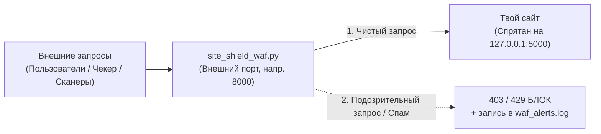

# 🛡️ Инструкция по защите сайта с помощью `site_shield_waf.py`

Этот документ — подробное руководство по настройке, запуску и использованию защитного экрана **[site_shield_waf.py](./site_shield_waf.py)** как для обычного веб-сайта, так и для сервисов на тренировке **Attack/Defense CTF**.

---

## 1. Принцип работы (простыми словами)

Скрипт работает по принципу **обратного прокси с фильтрацией (Reverse-Proxy WAF)**.  
Вместо того чтобы пускать всех посетителей напрямую к сайту, ты ставишь перед сайтом «охранника»:



### От чего именно он защищает:
1. **Флуд, спам и перебор паролей (`Rate Limit`)** — ограничивает число запросов с одного IP-адреса за 10 секунд.
2. **SQL-инъекции (`SQLi`)** — блокирует попытки вытащить базу через `UNION SELECT`, `' OR 1=1`, `DROP TABLE` и SQL-комментарии.
3. **Выход из папки (`Path Traversal`)** — блокирует попытки чтения системных и конфигурационных файлов (`../`, `/etc/passwd`, `.env`).
4. **XSS и инъекции системных команд** — отсекает `<script>`, `onerror=`, `; cat `, `| bash`, `$(...)`.
5. **Утечка системных ошибок (`Anti-Traceback`)** — если сайт упал с ошибкой `500` и вывел структуру кода (`Traceback`), экран скроет внутренности и вернёт аккуратную заглушку.

---

## 2. Как правильно настроить порты (важный шаг!)

Чтобы обойти защиту было невозможно напрямую по старому порту, используется классическая **схема рокировки портов**:

> [!IMPORTANT]
> **Пример рокировки (если твой сайт изначально работал на порту `5000`):**
> 1. В настройках самого сайта (или `docker-compose.yml`) меняешь его порт так, чтобы он слушал **только локально**: например, `127.0.0.1:5001:5000` (снаружи к порту `5001` никто подключиться не сможет).
> 2. В `site_shield_waf.py` ставишь:
>    - `LISTEN_PORT = 5000` *(старый внешний порт, куда привыкли ходить клиенты и чекер жюри)*;
>    - `BACKEND_URL = "http://127.0.0.1:5001"` *(новый внутренний адрес сайта)*.
>
> В итоге для внешнего мира адрес сайта **вообще не изменился**, но весь трафик теперь проходит сквозь фильтр!

---

## 3. Разбор настроек в файле `site_shield_waf.py`

Открой верхнюю часть файла `site_shield_waf.py` (строки 22–29):

| Параметр в коде | За что отвечает | Как настроить под себя |
| :--- | :--- | :--- |
| `LISTEN_HOST = "0.0.0.0"` | Какие сетевые интерфейсы слушать | Оставь `"0.0.0.0"`, чтобы принимать подключения из сети |
| `LISTEN_PORT = 8000` | Внешний порт защитного экрана | Укажи порт, на который заходят пользователи (или чекер) |
| `BACKEND_URL = "http://127.0.0.1:5000"` | Куда пересылать проверенные запросы | Впиши внутренний адрес и порт твоего сайта |
| `MAX_REQ_PER_10_SEC = 40` | Лимит запросов с одного IP за 10 сек | Для обычного сайта `40–60`; если сервис грузит много картинок — увеличь до `120` |
| `WHITELIST_IPS = {"127.0.0.1"}` | Белый список IP (без лимита скорости) | Сюда полезно добавить IP проверочной системы (жюри), например `{"127.0.0.1", "10.10.0.1"}` |
| `LOG_FILE = "waf_alerts.log"` | Имя файла журнала безопасности | Сюда записываются все заблокированные попытки |

---

## 4. Запуск защиты (на Windows и на Linux-сервере)

Никакие библиотеки через `pip` устанавливать не нужно — нужен только Python 3.10+.

### Вариант А: Запуск на Windows (для локальной проверки)
Открой терминал PowerShell в папке со скриптом и выполни:
```powershell
python site_shield_waf.py
```

### Вариант Б: Запуск на боевом Linux-сервере (по SSH)
Чтобы защита продолжала работать в фоне даже после того, как ты закроешь окно SSH, запускай через `nohup`:
```bash
# 1. Копируем скрипт на сервер со своего ноутбука:
scp site_shield_waf.py root@<IP_СЕРВЕРА>:/root/

# 2. Запускаем на сервере в фоновом режиме:
nohup python3 /root/site_shield_waf.py > /root/waf_stdout.log 2>&1 &

# 3. Проверяем, что процесс запущен и слушает порт:
ss -tulpn | grep python3
```

Чтобы остановить фоновый скрипт на Linux:
```bash
pkill -f site_shield_waf.py
```

---

## 5. Мониторинг атак и добавление своих правил на лету

### Как смотреть, кто пытается взломать сайт прямо сейчас
На Linux:
```bash
tail -f waf_alerts.log
```
На Windows (PowerShell):
```powershell
Get-Content waf_alerts.log -Wait -Tail 20
```

Пример записей в журнале:
```text
[2026-11-05 20:15:10] БЛОК | IP: 10.60.4.2 | Причина: SQL-инъекция | GET /api/search?q=' UNION SELECT ...
[2026-11-05 20:15:18] БЛОК | IP: 10.60.7.2 | Причина: Чтение чужих файлов (Path Traversal) | GET /download?f=../../.env
```

### Как за 10 секунд закрыть новую найденную дыру
Допустим, ты увидел, что на сайте забыта открытая отладочная страница `/api/debug/dump`.  
Даже не трогая код самого сайта, просто добавь строчку в список `WAF_SIGNATURES` в `site_shield_waf.py`:

```python
WAF_SIGNATURES = [
    # ... стандартные правила ...
    ("Запрещённый отладочный маршрут", re.compile(r"/api/debug/dump", re.IGNORECASE)),
]
```
Перезапусти `site_shield_waf.py` — и доступ к этой дыре мгновенно закрыт кодом `403`!

---

## 6. Проверка работы и техника безопасности на CTF

> [!WARNING]
> **Главное правило на CTF Attack/Defense:**  
> После запуска WAF обязательно посмотри на табло соревнований в следующий раунд!  
> Статус твоего сервиса должен остаться зелёным (**`UP`**). Если вдруг чекер жюри использует длинные запросы или делает много подключений подряд и статус сменился на `MUMBLE` или `DOWN`:
> 1. Посмотри последнюю строчку в `waf_alerts.log` — ты сразу увидишь, какое именно правило зацепило чекер.
> 2. Добавь IP чекера в `WHITELIST_IPS` или ослабь слишком строгое правило.

### Быстрая самопроверка после запуска
Открой две ссылки в браузере (подставив свой `LISTEN_PORT`, например `8000`):
1. `http://127.0.0.1:8000/` — должен открыться твой обычный сайт.
2. `http://127.0.0.1:8000/?test=../../etc/passwd` — должно появиться сообщение `{"status": "blocked", "reason": "Forbidden by Security Shield"}`, а в `waf_alerts.log` добавится запись о блокировке.
